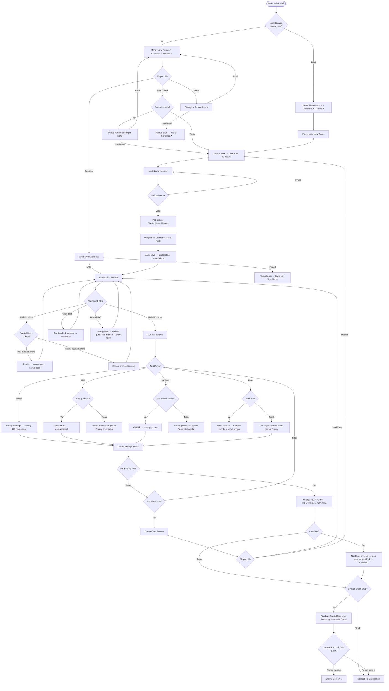
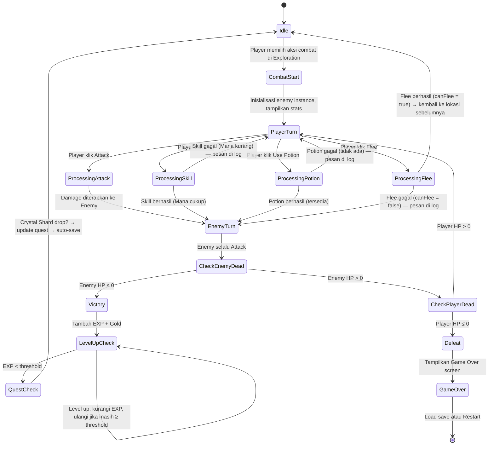

# Design Document

## Overview

**Legenda Eldoria** adalah aplikasi game RPG berbasis teks yang berjalan sepenuhnya di browser sebagai single-page static application. Pemain mengendalikan karakter petualang yang harus mengumpulkan tiga Crystal Shard, mengalahkan Dark Lord, dan menyelamatkan Kerajaan Eldoria.

### Tujuan Desain

- **Kesederhanaan teknis**: Tidak ada framework, build tool, atau dependency eksternal — hanya HTML, CSS, dan Vanilla JavaScript murni.
- **Portabilitas**: Dapat dibuka langsung via `file://` protokol dari disk lokal tanpa server.
- **Keamanan DOM**: Semua input pengguna dirender menggunakan `textContent` atau `createElement`, tidak pernah `innerHTML` langsung dari data pengguna.
- **Persistensi**: Progres disimpan otomatis ke `localStorage` setelah setiap event penting.

---

## Architecture

### Single-Page Application Pattern

Aplikasi menggunakan satu file `index.html` sebagai container utama. Perpindahan antar layar dilakukan dengan menampilkan/menyembunyikan `<div>` screen container menggunakan CSS `display` property, bukan navigasi URL.

```
┌──────────────────────────────────────────────────────┐
│                     index.html                       │
│  ┌──────────┐  ┌────────────┐  ┌──────────────────┐  │
│  │  #screen-  │  │  #screen-  │  │  #screen-combat  │  │
│  │   menu   │  │  char-    │  │                  │  │
│  │          │  │  create   │  │  (+ more screens)│  │
│  └──────────┘  └────────────┘  └──────────────────┘  │
│                                                      │
│  js/data.js (loaded first) → global DATA constants  │
│  js/game.js (loaded second) → all game logic        │
└──────────────────────────────────────────────────────┘
```

### Hubungan Antar File

```
index.html
  ├── <link> css/style.css       (styling & dark fantasy theme)
  ├── <script> js/data.js        (MUST load first — defines global constants)
  └── <script> js/game.js        (reads DATA constants, drives all logic)
```

`js/game.js` mengakses variabel global dari `js/data.js` secara langsung. Tidak ada mekanisme `import/export` (tidak menggunakan ES Modules).

### State Management

Seluruh state permainan disimpan dalam satu objek global `gameState` di `js/game.js`:

```javascript
// Singleton mutable state — satu-satunya sumber kebenaran saat runtime
let gameState = {
  character: null,      // Object Character aktif
  inventory: {},        // { healthPotion: 0, manaPotion: 0, crystalShard1: false, ... }
  quests: {},           // { crystal1: 'not_started', crystal2: '...', darkLord: '...' }
  currentLocation: null, // string location ID
  previousLocation: null, // untuk flee dari combat
  inCombat: false,
  currentEnemy: null,   // Object Enemy aktif saat combat
  battleLog: [],        // array string, max 100 entri
};
```

State tidak pernah dimodifikasi secara parsial dari fungsi arbitrary — semua perubahan dilakukan melalui fungsi mutator yang terdefinisi (`applyDamage`, `addExp`, `addItem`, dst.) untuk memastikan konsistensi.

### Screen Management

Setiap layar adalah sebuah `<div>` dengan `id` unik. Fungsi `showScreen(screenId)` menyembunyikan semua layar lalu menampilkan layar yang diminta:

```javascript
const SCREENS = ['menu', 'char-name', 'char-class', 'char-summary',
                 'exploration', 'combat', 'inventory', 'game-over', 'ending'];

function showScreen(id) {
  SCREENS.forEach(s => {
    document.getElementById('screen-' + s).style.display = 'none';
  });
  document.getElementById('screen-' + id).style.display = 'block';
}
```

---

## Components and Interfaces

### Komponen Utama

| Komponen | File | Tanggung Jawab |
|---|---|---|
| `DATA` constants | `js/data.js` | Definisi class, enemy, lokasi, item, skill |
| `gameState` | `js/game.js` | Runtime state tunggal |
| Screen Manager | `js/game.js` | Menampilkan/menyembunyikan layar |
| Character Factory | `js/game.js` | `createCharacter(name, classId)` |
| Combat Engine | `js/game.js` | `startCombat`, `processPlayerAction`, `processEnemyTurn` |
| Level System | `js/game.js` | `addExp(amount)`, `checkLevelUp()` |
| Inventory Manager | `js/game.js` | `addItem`, `useItem`, `canUseItem` |
| Quest Manager | `js/game.js` | `updateQuestStatus`, `checkQuestCompletion` |
| Save/Load System | `js/game.js` | `saveGame()`, `loadGame()`, `validateSaveData(data)` |
| Narrator | `js/game.js` | `renderLocation(locationId)` |
| DOM Utils | `js/game.js` | `setTextSafe(el, text)`, `createEl(tag, text, cls)` |

### Interface Antar Komponen

```
Player Input (click)
    │
    ▼
Event Handler (js/game.js)
    │
    ├─► gameState mutation (pure logic)
    │
    ├─► DOM update via DOM Utils (display)
    │
    └─► saveGame() if auto-save trigger
```

### DOM Utils — Keamanan Input

```javascript
// AMAN: semua teks dari user input harus melalui fungsi ini
function setTextSafe(element, text) {
  element.textContent = text; // Tidak pernah innerHTML
}

function createTextNode(text) {
  return document.createTextNode(String(text));
}
```

### HTML Structure (`index.html`)

```html
<!DOCTYPE html>
<html lang="id">
<head>
  <meta charset="UTF-8">
  <meta name="viewport" content="width=device-width, initial-scale=1.0">
  <title>Legenda Eldoria</title>
  <link rel="stylesheet" href="css/style.css">
</head>
<body>
  <div id="screen-menu" class="screen">...</div>
  <div id="screen-char-name" class="screen" style="display:none">...</div>
  <div id="screen-char-class" class="screen" style="display:none">...</div>
  <div id="screen-char-summary" class="screen" style="display:none">...</div>
  <div id="screen-exploration" class="screen" style="display:none">
    <aside id="panel-stats">...</aside>
    <main id="panel-narration">...</main>
    <aside id="panel-quest">...</aside>
  </div>
  <div id="screen-combat" class="screen" style="display:none">...</div>
  <div id="screen-inventory" class="screen" style="display:none">...</div>
  <div id="screen-game-over" class="screen" style="display:none">...</div>
  <div id="screen-ending" class="screen" style="display:none">...</div>

  <!-- Modal dialog konfirmasi (shared) -->
  <div id="modal-confirm" class="modal" style="display:none">
    <div class="modal-content">
      <p id="modal-message"></p>
      <button id="modal-btn-confirm">Ya</button>
      <button id="modal-btn-cancel">Batal</button>
    </div>
  </div>

  <script src="js/data.js"></script>
  <script src="js/game.js"></script>
</body>
</html>
```

---

## Data Models

### Character Object

```javascript
// Dibuat oleh createCharacter(name, classId), disimpan di gameState.character
{
  name: String,       // 1-20 karakter, teks literal
  classId: String,    // 'warrior' | 'mage' | 'ranger'
  hp: Number,         // current HP, 0 ≤ hp ≤ maxHp
  maxHp: Number,
  mana: Number,       // current Mana, 0 ≤ mana ≤ maxMana
  maxMana: Number,
  attack: Number,
  defense: Number,
  level: Number,      // 1–99
  exp: Number,        // 0 ≤ exp < expThreshold(level + 1)
  gold: Number,       // ≥ 0
}
```

### Enemy Object (template di `js/data.js`, instance di `gameState.currentEnemy`)

```javascript
// Template (DATA.ENEMIES)
{
  id: String,
  name: String,
  locationId: String,
  maxHp: Number,
  attack: Number,
  defense: Number,
  expReward: Number,
  goldReward: Number,
  canFlee: Boolean,         // apakah Player boleh Flee dari musuh ini
  dropsCrystalShard: String | null,  // 'crystal1' | 'crystal2' | 'crystal3' | null
}

// Instance runtime (clone dari template, tambah hp saat ini)
{
  ...template,
  hp: Number,  // current HP, dimulai dari maxHp
}
```

### Location Object (di `js/data.js`)

```javascript
{
  id: String,         // 'village' | 'forest' | 'cave' | 'ruins' | 'darklair'
  name: String,
  narration: String,  // Teks deskriptif unik per lokasi
  actions: [          // 1-6 aksi
    {
      label: String,       // Teks tombol
      type: String,        // 'combat' | 'item' | 'npc' | 'move' | 'quest'
      data: Object,        // Payload bergantung pada type
      condition: Function | null,  // fn(gameState) → Boolean; null = selalu tampil
    }
  ],
  requiredCrystals: Number,  // 0 untuk semua lokasi kecuali darklair (= 3)
}
```

### Item Definitions (di `js/data.js`)

```javascript
const DATA = {
  ITEMS: {
    healthPotion: {
      id: 'healthPotion',
      name: 'Health Potion',
      maxStack: 99,
      hpRestore: 50,
      usableInCombat: true,
      questItem: false,
    },
    manaPotion: {
      id: 'manaPotion',
      name: 'Mana Potion',
      maxStack: 99,
      manaRestore: 30,
      usableInCombat: false,
      questItem: false,
    },
    crystalShard1: { id: 'crystalShard1', name: 'Crystal Shard (Hutan)', maxStack: 1, questItem: true },
    crystalShard2: { id: 'crystalShard2', name: 'Crystal Shard (Gua)',   maxStack: 1, questItem: true },
    crystalShard3: { id: 'crystalShard3', name: 'Crystal Shard (Reruntuhan)', maxStack: 1, questItem: true },
  }
};
```

### Skill Definitions (di `js/data.js`)

```javascript
const DATA = {
  SKILLS: {
    warrior: [
      { id: 'powerStrike',  name: 'Power Strike', manaCost: 15, type: 'damage', value: 30,
        description: 'Serangan keras yang mengabaikan sebagian defense.' },
      { id: 'battleCry',    name: 'Battle Cry',   manaCost: 10, type: 'heal',   value: 25,
        description: 'Teriakan perang yang memulihkan semangat dan HP.' },
    ],
    mage: [
      { id: 'fireball',     name: 'Fireball',     manaCost: 25, type: 'damage', value: 45,
        description: 'Bola api yang membakar musuh.' },
      { id: 'arcaneHeal',   name: 'Arcane Heal',  manaCost: 20, type: 'heal',   value: 40,
        description: 'Mantra penyembuhan arkan.' },
    ],
    ranger: [
      { id: 'arrowRain',    name: 'Arrow Rain',   manaCost: 20, type: 'damage', value: 35,
        description: 'Hujan anak panah yang menghujam musuh.' },
      { id: 'natureMend',   name: 'Nature Mend',  manaCost: 15, type: 'heal',   value: 30,
        description: 'Kekuatan alam yang memulihkan luka.' },
    ],
  }
};
```

### Quest State

```javascript
// Bagian dari gameState.quests
{
  crystal1: 'not_started' | 'in_progress' | 'completed',
  crystal2: 'not_started' | 'in_progress' | 'completed',
  crystal3: 'not_started' | 'in_progress' | 'completed',
  darkLord: 'not_started' | 'in_progress' | 'completed',
}
```

### Inventory State

```javascript
// Bagian dari gameState.inventory
{
  healthPotion: Number,   // 0–99
  manaPotion:   Number,   // 0–99
  crystalShard1: Boolean, // true | false
  crystalShard2: Boolean,
  crystalShard3: Boolean,
}
```

### Save Data Schema (JSON di localStorage)

```javascript
// Key: 'legenda_eldoria_save'
{
  character: {
    name: String,
    classId: String,
    hp: Number,
    maxHp: Number,
    mana: Number,
    maxMana: Number,
    attack: Number,
    defense: Number,
    level: Number,
    exp: Number,
    gold: Number,
  },
  inventory: {
    healthPotion: Number,
    manaPotion: Number,
    crystalShard1: Boolean,
    crystalShard2: Boolean,
    crystalShard3: Boolean,
  },
  quests: {
    crystal1: String,
    crystal2: String,
    crystal3: String,
    darkLord: String,
  },
  currentLocation: String,
  version: '1.0',  // untuk forward-compatibility check
}
```

#### Required Fields untuk Validasi Load

Saat memuat save, semua field berikut harus ada dan valid:

| Field | Tipe | Constraint |
|---|---|---|
| `character.name` | string | panjang 1–20 |
| `character.classId` | string | `'warrior'` / `'mage'` / `'ranger'` |
| `character.hp` | integer | 1 ≤ hp ≤ maxHp |
| `character.maxHp` | integer | ≥ 1 |
| `character.mana` | integer | 0 ≤ mana ≤ maxMana |
| `character.maxMana` | integer | ≥ 0 |
| `character.attack` | integer | ≥ 1 |
| `character.defense` | integer | ≥ 0 |
| `character.level` | integer | 1–99 |
| `character.exp` | integer | ≥ 0 |
| `character.gold` | integer | ≥ 0 |
| `inventory.healthPotion` | integer | 0–99 |
| `inventory.manaPotion` | integer | 0–99 |
| `inventory.crystalShard1` | boolean | — |
| `inventory.crystalShard2` | boolean | — |
| `inventory.crystalShard3` | boolean | — |
| `quests.crystal1` | string | valid Quest_Status |
| `quests.crystal2` | string | valid Quest_Status |
| `quests.crystal3` | string | valid Quest_Status |
| `quests.darkLord` | string | valid Quest_Status |
| `currentLocation` | string | salah satu dari 5 location ID |

### Enemy Data per Lokasi (di `js/data.js`)

```javascript
const DATA = {
  ENEMIES: [
    // Desa Eldoria (level 1-2 area, tutorial zone)
    { id: 'goblin',       name: 'Goblin Pencuri',   locationId: 'village',
      maxHp: 30,  attack: 8,  defense: 2,  expReward: 20, goldReward: 10,
      canFlee: true,  dropsCrystalShard: null },
    { id: 'wolf',         name: 'Serigala Hutan',   locationId: 'village',
      maxHp: 40,  attack: 10, defense: 3,  expReward: 30, goldReward: 15,
      canFlee: true,  dropsCrystalShard: null },
    { id: 'bandit',       name: 'Bandit Jalanan',   locationId: 'village',
      maxHp: 50,  attack: 12, defense: 4,  expReward: 40, goldReward: 20,
      canFlee: true,  dropsCrystalShard: null },

    // Hutan Terlarang (level 2-3, drops Crystal Shard 1)
    { id: 'darkElf',      name: 'Peri Gelap',       locationId: 'forest',
      maxHp: 65,  attack: 14, defense: 5,  expReward: 55, goldReward: 25,
      canFlee: true,  dropsCrystalShard: null },
    { id: 'treeSpirit',   name: 'Roh Pohon Jahat',  locationId: 'forest',
      maxHp: 80,  attack: 16, defense: 6,  expReward: 70, goldReward: 30,
      canFlee: true,  dropsCrystalShard: null },
    { id: 'forestGuardian', name: 'Penjaga Hutan',  locationId: 'forest',
      maxHp: 100, attack: 18, defense: 7,  expReward: 90, goldReward: 40,
      canFlee: false, dropsCrystalShard: 'crystal1' },

    // Gua Kristal (level 3-4, drops Crystal Shard 2)
    { id: 'stoneTroll',   name: 'Troll Batu',       locationId: 'cave',
      maxHp: 120, attack: 20, defense: 9,  expReward: 100, goldReward: 45,
      canFlee: true,  dropsCrystalShard: null },
    { id: 'crystalGolem', name: 'Golem Kristal',    locationId: 'cave',
      maxHp: 140, attack: 22, defense: 10, expReward: 120, goldReward: 55,
      canFlee: true,  dropsCrystalShard: null },
    { id: 'caveWyrm',     name: 'Wyrm Gua',         locationId: 'cave',
      maxHp: 160, attack: 24, defense: 11, expReward: 150, goldReward: 65,
      canFlee: false, dropsCrystalShard: 'crystal2' },

    // Reruntuhan Kuno (level 4-5, drops Crystal Shard 3)
    { id: 'ancientWarrior', name: 'Pejuang Kuno',   locationId: 'ruins',
      maxHp: 180, attack: 26, defense: 12, expReward: 170, goldReward: 70,
      canFlee: true,  dropsCrystalShard: null },
    { id: 'cursedKnight', name: 'Ksatria Terkutuk', locationId: 'ruins',
      maxHp: 200, attack: 28, defense: 13, expReward: 190, goldReward: 80,
      canFlee: true,  dropsCrystalShard: null },
    { id: 'ruinsColossus', name: 'Kolosus Reruntuhan', locationId: 'ruins',
      maxHp: 220, attack: 30, defense: 14, expReward: 220, goldReward: 90,
      canFlee: false, dropsCrystalShard: 'crystal3' },

    // Sarang Penguasa Kegelapan (level 5+, boss fight)
    { id: 'darkMinion',   name: 'Pengikut Kegelapan', locationId: 'darklair',
      maxHp: 240, attack: 32, defense: 15, expReward: 200, goldReward: 100,
      canFlee: true,  dropsCrystalShard: null },
    { id: 'darkLord',     name: 'Penguasa Kegelapan', locationId: 'darklair',
      maxHp: 350, attack: 38, defense: 18, expReward: 500, goldReward: 300,
      canFlee: false, dropsCrystalShard: null },  // boss — triggers ending on defeat
  ]
};
```

---

## Correctness Properties

*A property is a characteristic or behavior that should hold true across all valid executions of a system — essentially, a formal statement about what the system should do. Properties serve as the bridge between human-readable specifications and machine-verifiable correctness guarantees.*

### Property 1: Damage Formula Non-Zero

*For any* Character-Enemy pair in combat, the calculated damage (attacker.attack - defender.defense) SHALL always be at least 1, regardless of how high the defender's defense is relative to the attacker's attack.

**Validates: Requirements 4.3, 4.10**

### Property 2: HP Clamping Invariant

*For any* combat action that changes HP (attack, heal, potion use), the resulting HP of any entity SHALL always satisfy `0 ≤ entity.hp ≤ entity.maxHp` — it never goes negative or exceeds the maximum.

**Validates: Requirements 4.11**

### Property 3: Level-Up EXP Carry-Over

*For any* amount of EXP awarded after combat, the Character's final (level, exp) state SHALL satisfy: `0 ≤ character.exp < expThreshold(character.level + 1)`, even when the awarded EXP causes multiple consecutive level-ups (carry-over chain).

**Validates: Requirements 5.2, 5.5, 5.6**

### Property 4: Save Data Round-Trip

*For any* valid `gameState`, serializing it to JSON via `saveGame()` then deserializing and loading via `loadGame()` SHALL produce an equivalent `gameState` with all fields matching their original values within the valid ranges defined in the schema.

**Validates: Requirements 8.4, 8.5**

### Property 5: Character Name XSS Safety

*For any* character name string (including strings containing `<`, `>`, `&`, `"`, `'`, and script tags), rendering the name in the DOM via `setTextSafe()` SHALL result in the raw string being displayed literally without any HTML interpretation or script execution.

**Validates: Requirements 2.4, 9.1**

### Property 6: Inventory Potion Quantity Consistency

*For any* sequence of Health Potion additions and uses, the quantity in inventory SHALL equal the total items added minus the total items used, and SHALL always remain within `[0, 99]`.

**Validates: Requirements 6.1, 6.2**

### Property 7: Crystal Shard Quest State Monotonicity

*For any* Crystal Shard quest state, the status SHALL only transition forward (`not_started` → `in_progress` → `completed`) and SHALL never revert to a previous state once advanced.

**Validates: Requirements 7.2, 7.4, 7.5**

### Property 8: Dark Lair Access Gate

*For any* game state where fewer than three Crystal Shards have `completed` status, attempting to navigate to the Dark Lair location SHALL leave `gameState.currentLocation` unchanged and display a rejection message.

**Validates: Requirements 3.11, 3.12**

### Property 9: Battle Log Size Bound

*For any* combat session with arbitrarily many turns, the `gameState.battleLog` array SHALL never exceed 100 entries — older entries are dropped when the limit is reached.

**Validates: Requirements 4.14**

### Property 10: Max Level Cap

*For any* EXP award to a Level-99 Character, the Character's level SHALL remain 99 and their EXP SHALL NOT increase beyond the threshold for Level 99.

**Validates: Requirements 5.8**

---

## Error Handling

### Save/Load Errors

```javascript
function saveGame() {
  try {
    const data = JSON.stringify(buildSaveData(gameState));
    localStorage.setItem('legenda_eldoria_save', data);
  } catch (e) {
    // localStorage penuh atau tidak tersedia
    showWarning('Peringatan: Progres tidak dapat disimpan. localStorage tidak tersedia atau penuh.');
  }
}

function loadGame() {
  let raw;
  try {
    raw = localStorage.getItem('legenda_eldoria_save');
  } catch (e) {
    showError('Penyimpanan lokal tidak tersedia. Tidak dapat melanjutkan game.');
    return null;
  }
  if (!raw) return null;

  let data;
  try {
    data = JSON.parse(raw);
  } catch (e) {
    showError('Data simpanan rusak (bukan JSON valid). Silakan mulai New Game.');
    return null;
  }

  const validationResult = validateSaveData(data);
  if (!validationResult.valid) {
    showError('Data simpanan tidak lengkap atau tidak valid. Silakan mulai New Game.');
    return null;
  }

  return data;
}
```

### Validasi Input Karakter

```javascript
function validateCharacterName(name) {
  const trimmed = name.trim();
  if (trimmed.length === 0) return { valid: false, reason: 'Nama tidak boleh kosong atau hanya spasi.' };
  if (trimmed.length > 20) return { valid: false, reason: 'Nama tidak boleh lebih dari 20 karakter.' };
  return { valid: true };
}
```

### Error Boundary Pattern

Semua event handler di-wrap dengan try-catch ringan untuk mencegah crash total:

```javascript
document.getElementById('btn-attack').addEventListener('click', function () {
  try {
    handlePlayerAttack();
  } catch (e) {
    console.error('Combat error:', e);
    // Tampilkan pesan minimal tanpa mengubah state lebih lanjut
    addToBattleLog('[Error: aksi tidak dapat diproses]');
  }
});
```

### localStorage Tidak Tersedia

Saat halaman dimuat, cek ketersediaan `localStorage` sekali:

```javascript
function isLocalStorageAvailable() {
  try {
    localStorage.setItem('__test__', '1');
    localStorage.removeItem('__test__');
    return true;
  } catch (e) {
    return false;
  }
}
```

Jika tidak tersedia: tombol "Continue" dinonaktifkan, banner peringatan ditampilkan.

---

## Testing Strategy

### Dual Approach: Unit Tests + Property-Based Tests

Pengujian menggunakan dua lapisan komplementer:

1. **Unit Tests (example-based)**: Memverifikasi perilaku konkret dengan contoh spesifik
2. **Property Tests (PBT)**: Memverifikasi properti universal di atas banyak input acak

Karena game ini menggunakan Vanilla JS tanpa framework, library testing yang disarankan:
- **Unit tests**: [Vitest](https://vitest.dev/) atau [Jest](https://jestjs.io/) dengan jsdom
- **Property-based tests**: [fast-check](https://fast-check.dev/) — mendukung arbitrary generators untuk JavaScript/TypeScript

Minimum **100 iterasi** per property test (default fast-check).

### Unit Tests (Contoh Spesifik)

| Test | Deskripsi |
|---|---|
| `createCharacter('Aragorn', 'warrior')` | Stats awal Warrior benar |
| `validateCharacterName('')` | Nama kosong ditolak |
| `validateCharacterName(' ')` | Nama hanya spasi ditolak |
| `validateCharacterName('A'.repeat(21))` | Nama > 20 char ditolak |
| Load save dengan field `level: 0` | Ditolak dengan pesan error |
| Load save dengan JSON rusak `'{bad'` | Ditolak dengan pesan error |
| Flee dari musuh dengan `canFlee: false` | Ditolak, pesan di battle log |
| Penggunaan Skill tanpa cukup Mana | Ditolak, giliran Enemy tidak jalan |
| Dark Lair dengan 2 Crystal Shard | Akses ditolak, lokasi tidak berubah |

### Property-Based Tests

Setiap property test harus di-tag dengan komentar:

```javascript
// Feature: fantasy-text-rpg, Property 1: Damage Formula Non-Zero
test.prop([fc.integer(), fc.integer()])(
  'damage selalu minimum 1',
  (attack, defense) => {
    const damage = Math.max(1, attack - defense);
    return damage >= 1;
  }
);
```

| Property | Library | Generator | Minimal Iter |
|---|---|---|---|
| **P1** Damage ≥ 1 | fast-check | `fc.integer()` pair | 100 |
| **P2** HP Clamping | fast-check | random combat sequences | 100 |
| **P3** EXP Carry-Over | fast-check | `fc.nat()` exp amounts | 100 |
| **P4** Save Round-Trip | fast-check | arbitrary gameState | 100 |
| **P5** XSS Safety | fast-check | `fc.string()` with special chars | 100 |
| **P6** Inventory Consistency | fast-check | add/use sequences | 100 |
| **P7** Quest Monotonicity | fast-check | event sequences | 100 |
| **P8** Dark Lair Gate | fast-check | crystal count 0–2 | 100 |
| **P9** Battle Log Bound | fast-check | high turn count | 100 |
| **P10** Level 99 Cap | fast-check | large EXP at level 99 | 100 |

### Manual Test Checklist

- [ ] Buka `index.html` langsung dari disk (file:// protokol) di Chrome, Firefox, Edge
- [ ] New Game → buat karakter → verifikasi stats sesuai class
- [ ] Buat karakter Warrior → cek HP 120, Mana 30, Atk 15, Def 12
- [ ] Ketik nama dengan `<script>alert(1)</script>` → verifikasi ditampilkan sebagai teks literal
- [ ] Lakukan combat beberapa ronde → verifikasi battle log tidak lebih dari 100 entri
- [ ] Level up → verifikasi stat increases dan notifikasi muncul
- [ ] Multiple level-ups dari satu combat → verifikasi carry-over EXP benar
- [ ] Coba akses Sarang dengan 0, 1, 2 Crystal Shard → ditolak dengan pesan jumlah yang kurang
- [ ] Kumpulkan 3 Crystal Shard → akses Sarang terbuka
- [ ] Kalahkan Dark Lord → layar ending muncul
- [ ] Auto-save setelah combat, pindah lokasi, quest update
- [ ] Reset game → localStorage terhapus, Continue dinonaktifkan
- [ ] Continue → stats dan lokasi tersimpan dengan benar
- [ ] Resize viewport ke 320px → tidak ada horizontal scroll
- [ ] Console browser tidak ada error selama alur normal

---

## Game Flow Diagram



---

## Combat State Machine



---

## UI/UX Design

### Layout Utama (Exploration Screen)

```
┌─────────────────────────────────────────────────────────────┐
│  LEGENDA ELDORIA                          [Inventory Button] │
├──────────────┬──────────────────────────┬───────────────────┤
│  CHARACTER   │   NARRATION AREA         │   QUEST PANEL     │
│  STATS       │                          │                   │
│  ──────────  │  [Location Name]         │  ○ Crystal 1      │
│  Name: ...   │  [Narration text...]     │  ○ Crystal 2      │
│  Class: ...  │                          │  ○ Crystal 3      │
│  HP: x/y     │  ─────────────────────  │  ○ Dark Lord      │
│  Mana: x/y   │  [Action Button 1]       │                   │
│  ATK: ...    │  [Action Button 2]       │                   │
│  DEF: ...    │  [Action Button 3]       │                   │
│  LV: ...     │  [Action Button 4-6]     │                   │
│  EXP: x/y    │                          │                   │
│  Gold: ...   │                          │                   │
└──────────────┴──────────────────────────┴───────────────────┘
```

### Layout Combat Screen

```
┌──────────────────────────────────────────────────────────────┐
│  COMBAT                                                      │
│  ┌──────────────────────────┐  ┌──────────────────────────┐  │
│  │  PLAYER                  │  │  ENEMY                   │  │
│  │  Name: ...               │  │  Name: ...               │  │
│  │  HP: ███████░░░ 80/120   │  │  HP: ████░░░░░░ 40/100   │  │
│  │  Mana: █████░░░ 50/100   │  │  ATK: ...   DEF: ...     │  │
│  └──────────────────────────┘  └──────────────────────────┘  │
│  ─────────────────────────────────────────────────────────   │
│  BATTLE LOG                                                   │
│  > Player menyerang Goblin! Damage: 13                       │
│  > Goblin menyerang Player! Damage: 7                        │
│  > ...                                                        │
│  ─────────────────────────────────────────────────────────   │
│  [Attack]   [Skill]   [Use Potion]   [Flee]                  │
└──────────────────────────────────────────────────────────────┘
```

### CSS Custom Properties (Dark Fantasy Palette)

```css
:root {
  /* Color Palette */
  --color-bg-primary:    #0d0d1a;  /* Deep dark navy — main background */
  --color-bg-secondary:  #1a1a2e;  /* Panel backgrounds */
  --color-bg-tertiary:   #16213e;  /* Card/section backgrounds */
  --color-border:        #2a2a4a;  /* Subtle borders */
  --color-border-accent: #4a3f6b;  /* Highlighted borders */

  --color-text-primary:  #e8e0f0;  /* Main readable text */
  --color-text-secondary:#a89bc0;  /* Secondary/muted text */
  --color-text-accent:   #c9a227;  /* Gold accent — rewards, headings */

  --color-hp-bar:        #c0392b;  /* HP bar fill */
  --color-hp-bg:         #3d1515;  /* HP bar background */
  --color-mana-bar:      #2980b9;  /* Mana bar fill */
  --color-mana-bg:       #152035;  /* Mana bar background */
  --color-exp-bar:       #27ae60;  /* EXP bar fill */

  --color-btn-primary:   #4a3f6b;  /* Primary action button */
  --color-btn-hover:     #6a5f8b;  /* Button hover */
  --color-btn-danger:    #7d2020;  /* Danger/flee button */
  --color-btn-disabled:  #2a2a3a;  /* Disabled state */

  --color-success:       #27ae60;
  --color-warning:       #f39c12;
  --color-error:         #e74c3c;

  /* Typography */
  --font-primary:  'Georgia', 'Times New Roman', serif;  /* Narasi */
  --font-ui:       'Courier New', monospace;             /* Stats, UI */

  /* Spacing */
  --spacing-sm:   8px;
  --spacing-md:  16px;
  --spacing-lg:  24px;
  --spacing-xl:  32px;

  /* Border radius */
  --radius-sm:  4px;
  --radius-md:  8px;

  /* Transitions */
  --transition-fast:   0.15s ease;
  --transition-normal: 0.3s ease;
}
```

### Responsive Breakpoints

```css
/* Mobile-first: 320px base */
.exploration-layout {
  display: flex;
  flex-direction: column;  /* stacked di mobile */
  gap: var(--spacing-md);
}

/* Tablet: ≥ 640px */
@media (min-width: 640px) {
  .exploration-layout {
    display: grid;
    grid-template-columns: 180px 1fr;  /* stats | main */
  }
  .quest-panel { display: block; }
}

/* Desktop: ≥ 1024px */
@media (min-width: 1024px) {
  .exploration-layout {
    grid-template-columns: 200px 1fr 200px;  /* stats | main | quest */
  }
}
```

### Animasi CSS (Minimal)

```css
/* HP bar berubah warna saat kritis */
.hp-bar { transition: width var(--transition-normal); }
.hp-bar.critical { background-color: var(--color-warning); }

/* Button feedback */
.btn-action:hover  { background-color: var(--color-btn-hover); transition: background-color var(--transition-fast); }
.btn-action:active { transform: scale(0.97); }

/* Screen fade-in */
.screen { animation: fadeIn 0.2s ease; }
@keyframes fadeIn { from { opacity: 0; } to { opacity: 1; } }

/* Level up notifikasi pop */
.level-up-notice { animation: popIn 0.3s ease; }
@keyframes popIn {
  0%   { transform: scale(0.8); opacity: 0; }
  100% { transform: scale(1);   opacity: 1; }
}
```
